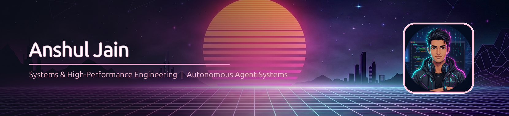

<p align="center">
  
</p>

<h1 align="center">Hey there, I'm <span style="color:#EF93C4;">Anshul Jain</span> 👋</h1>

<p align="center">
  
</p>

<p align="center">
  <a href="https://github.com/Anshulkaocde123"></a>
  <a href="https://github.com/Anshulkaocde123"></a>
  
</p>

<p align="center">
  <a href="https://linkedin.com" target="_blank"></a>
  <a href="mailto:anshuljain532006@gmail.com"></a>
  <a href="https://github.com/Anshulkaocde123"></a>
  <a href="https://discord.com"></a>
</p>

---

<h2 align="center">👨‍💻 A Little More About Me</h2>

<table align="center">
<tr>
<td width="72%" valign="top">

- ⚡ **High-Performance Systems & eBPF:** Engineering zero-copy packet scheduling with eBPF and AF_XDP for sub-microsecond kernel bypass (`chronos-x`).
- 🛡️ **Autonomous Multi-Agent AI & AST Guardrails:** Architecting high-concurrency incident response pipelines with strict AST verification, O(1) deduplication, and HMAC-SHA256 audit chaining (`switchguard-sre`).
- 💾 **Storage Engines & Financial Ledgers:** Designing persistent B+ Tree disk indexing engines (`bptree-kvstore`) and distributed double-entry ledgers with ACID compliance (`ledger-api`).
- 🤖 **Zero-Hallucination Tool Callers:** Building low-latency deterministic agent execution without bloated frameworks (`honest-tool-caller`).
- 🎓 **Education & Leadership:** Computer Science & Engineering · Visvesvaraya National Institute of Technology (VNIT), Nagpur · Active core developer at VNIT ACM.

</td>
<td width="28%" align="center" valign="middle">


</td>
</tr>
</table>

```typescript
const Anshul = {
    role: "Systems & High-Performance Cloud-Native Engineer",
    institution: "VNIT Nagpur (Visvesvaraya National Institute of Technology)",
    location: "Nagpur, India",
    domains: [
        "Kernel Bypass & Low-Latency Networking (eBPF / AF_XDP)",
        "Autonomous Multi-Agent Incident Pipelines & AST Security",
        "Persistent Database Storage Engines (B+ Trees)",
        "Distributed Double-Entry Financial Ledgers"
    ],
    languages: {
        systems: ["Rust", "C++", "C", "eBPF / XDP", "Bash / Shell"],
        backend_ai: ["Python", "TypeScript", "Node.js", "SQL"]
    },
    architecture: {
        networking_storage: ["AF_XDP Bypass", "B+ Tree Disk Indexer", "POSIX flock & fsync"],
        agentic_systems: ["Multi-Agent DAGs", "AST Static Verification", "Tool-Calling APIs"],
        distributed_concurrency: ["Redis", "BullMQ", "PostgreSQL", "Socket.io", "Docker"]
    },
    currentFocus: "Sub-millisecond packet schedulers, kernel-level telemetry, and zero-trust agent isolation boundaries",
    motto: "Zero bloat. Deterministic execution. Performance down to the microsecond."
};
```

---

<h2 align="center">💻 Technical Arsenal</h2>

<p align="center">
  
</p>

---

<h2 align="center">🚀 Featured Systems &amp; Projects</h2>

### 🛡️ [SwitchGuard SRE — Autonomous Multi-Agent Incident Response Pipeline](https://github.com/Anshulkaocde123/switchguard-sre)
> <span style="color:#EF93C4;">**Security:**</span> `16 AST Guardrails (AST-SEC-00..15)` &nbsp;|&nbsp; <span style="color:#EF93C4;">**Concurrency:**</span> `POSIX flock & fsync` &nbsp;|&nbsp; <span style="color:#EF93C4;">**Latency:**</span> `<0.5ms Dedup Fingerprint`

- Hybrid Rust + Python autonomous incident response pipeline hardened for **1,000,000+ alert storms** and concurrent workloads.
- Features **O(1) canonical fault fingerprint deduplication** in $<0.5\text{ms}$ with zero-width character stripping and random untrusted envelopes.
- Enforces an automated test reproduction sandbox (`sre-repro`) with **16 AST static security rules** (blocking code execution, evasion primitives, and assertion deletion).
- Implements **tamper-evident HMAC-SHA256 hash chaining** across hotfix releases with immutable kernel-locked ledgers.
- **Stack:** `Rust` · `Python` · `FastAPI` · `Pytest` · `POSIX flock` · `Docker` · `HMAC-SHA256`

<br/>

### ⚡ [Chronos-X — High-Performance Packet Scheduler](https://github.com/Anshulkaocde123/chronos-x)
> <span style="color:#EF93C4;">**Kernel Bypass:**</span> `AF_XDP Sockets` &nbsp;|&nbsp; <span style="color:#EF93C4;">**Latency:**</span> `Sub-microsecond` &nbsp;|&nbsp; <span style="color:#EF93C4;">**Architecture:**</span> `Zero-Copy Ring Buffers`

- Ultra-low latency network packet scheduler operating directly at the Linux kernel driver boundary.
- Leverages **eBPF and AF_XDP (XDP sockets)** to bypass the standard Linux TCP/IP network stack for zero-copy memory transfers.
- Implements custom priority queueing algorithms on high-throughput ring buffers to eliminate jitter and head-of-line blocking under extreme line rates.
- **Stack:** `C` · `C++` · `eBPF` · `AF_XDP` · `Linux Kernel Architecture`

<br/>

### 💾 [B+ Tree Storage Engine &amp; Financial Ledger API](https://github.com/Anshulkaocde123/bptree-kvstore)
> <span style="color:#EF93C4;">**Durability:**</span> `Disk-Backed Pages` &nbsp;|&nbsp; <span style="color:#EF93C4;">**Consistency:**</span> `ACID Double-Entry` &nbsp;|&nbsp; <span style="color:#EF93C4;">**Queue:**</span> `BullMQ & Redis`

- High-throughput persistent **B+ Tree database storage engine** in C++ featuring disk-backed page serialization, balanced node splits, and binary search range queries.
- Paired with a **financial-grade double-entry ledger** ([`ledger-api`](https://github.com/Anshulkaocde123/ledger-api)) enforcing immutable audit logs, serializable balance checks, and distributed BullMQ transaction jobs.
- **Stack:** `C++` · `Node.js` · `PostgreSQL` · `Redis` · `BullMQ` · `Express`

<br/>

### 🤖 [Honest Tool Caller &amp; VNIT ACM Platforms](https://github.com/Anshulkaocde123/honest-tool-caller)
> <span style="color:#EF93C4;">**Precision:**</span> `Zero Hallucination` &nbsp;|&nbsp; <span style="color:#EF93C4;">**Protocol:**</span> `Gemini Tool-Calling` &nbsp;|&nbsp; <span style="color:#EF93C4;">**Real-Time:**</span> `Socket.io Streaming`

- Minimalist, framework-free autonomous CLI assistant utilizing Google Gemini's raw tool-calling API with zero orchestration bloat.
- Real-time scoring systems and infrastructure for VNIT student councils and sports tournaments ([`vnit-ig-sports-app`](https://github.com/Anshulkaocde123/vnit-ig-sports-app)) supporting multi-department concurrent live updates.
- **Stack:** `Python` · `Gemini API` · `React` · `Node.js` · `Socket.io` · `MongoDB`

---

<h2 align="center">🐍 Contribution Activity Snake</h2>

<p align="center">
  <picture>
    <source media="(prefers-color-scheme: dark)" srcset="https://raw.githubusercontent.com/Anshulkaocde123/Anshulkaocde123/output/github-contribution-grid-snake-dark.svg">
    <source media="(prefers-color-scheme: light)" srcset="https://raw.githubusercontent.com/Anshulkaocde123/Anshulkaocde123/output/github-contribution-grid-snake.svg">
    
  </picture>
</p>

---

<h2 align="center">📈 GitHub Live Analytics</h2>

<p align="center">
  
</p>

<p align="center">
  
  
</p>

---

<p align="center">
  <sub>Designed &amp; Maintained by <b style="color:#EF93C4;">Anshul Jain</b> · Systems &amp; High-Performance Cloud-Native Engineering</sub>
</p>
